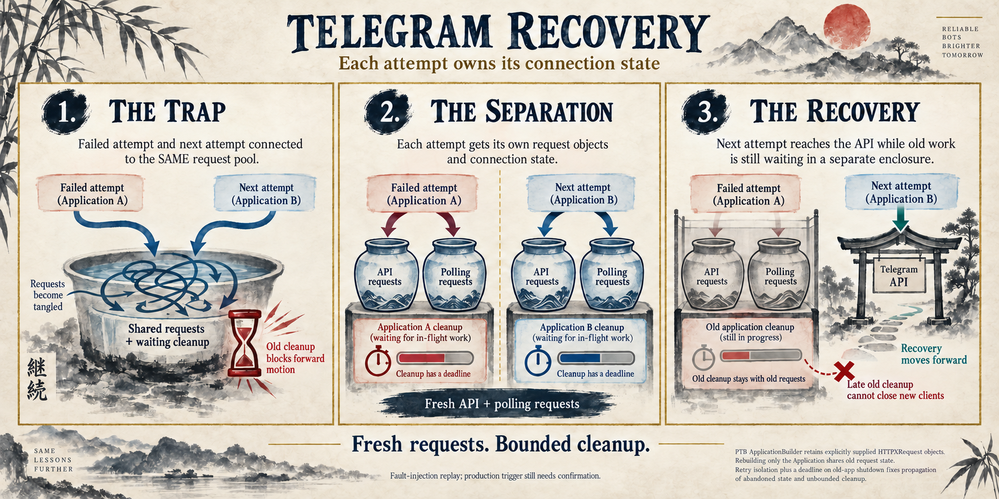

# Telegram initialization recovery

[View the infographic](https://raw.githubusercontent.com/JoaoMarcos44/hermes-agent/2dd9a166f509e60979a6824c1992add6a8816eac/infographic.png) · [Draft PR #139277](https://github.com/NousResearch/hermes-agent/pull/139277)

The gateway builds a Telegram application using two HTTP requests: one for API calls and one for polling. PTB's builder retains those request objects. Rebuilding only the application therefore carries the failed attempt's connection state into its successor. Waiting indefinitely for the old application's shutdown can also stop the retry ladder before the next attempt starts.

Each retry now gets fresh API and polling requests through the existing factory. Old-app shutdown uses the existing deadline helper, so recovery can advance while old work is still waiting. Delayed cleanup only touches the old request pair.

Two invariant tests exercise real PTB and HTTPX against a loopback Bot API. The timeout case injects a cancellation-resistant wait before a socket and holds old-app shutdown; it covers direct, proxy, and fallback request construction. The transient-error case checks that late cleanup leaves the new bot usable. All four cases fail on main `73456e11` and pass with the fix; the selected six-file suite passes 48 tests.

This proves the retry lifecycle defects and recovery under controlled faults. The original production trigger, its recurrence after process restarts, and the reporter's Linux aarch64 environment still require reporter-side confirmation.

To collect that missing evidence, each initialization timeout now reports the suspended Python await chain for its own task, before cancellation or cleanup erases it. The diagnostic contains only source basenames, line numbers, and function names. The existing tests also verify the blocked transport/event frames and exclusion of the dummy token and URL.

The native image generator produced `infographic.png` using a Japanese sumi-e theme. The PR body links directly to the image and embeds a preview. The image is hosted in `JoaoMarcos44/hermes-agent`, on the separate `docs/telegram-init-138649-infographic` branch. Its public URL is pinned to artifact commit `2dd9a166f509e60979a6824c1992add6a8816eac`, so later documentation edits do not change the image. No GitHub Assets or release attachments are used.

The PNG was never tracked on the PR's code branch, `fix/telegram-init-attempt-isolation`; it is committed only on the separate artifact branch. The current PR diff contains exactly the Telegram adapter, its connection helper, and the regression test file. Earlier code-branch commits included working reports; those reports have already been removed from the final diff. The reports and their history remain available without rewriting code commits.

This report, validation evidence, decision ledger, prompt, and publishing helper live alongside the image in the artifact branch. The PR body links the reports at an immutable documentation commit. Local `infographic.png` and `infographic_report.md` remain available for preview; the relative image embed above works locally and in the artifact branch.

See [the decision ledger](audit/issue-138649/decision-ledger.jsonl) for accepted and rejected hypotheses and replay evidence.
